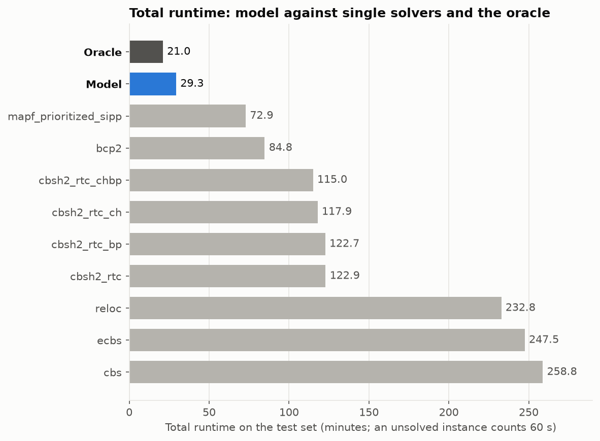
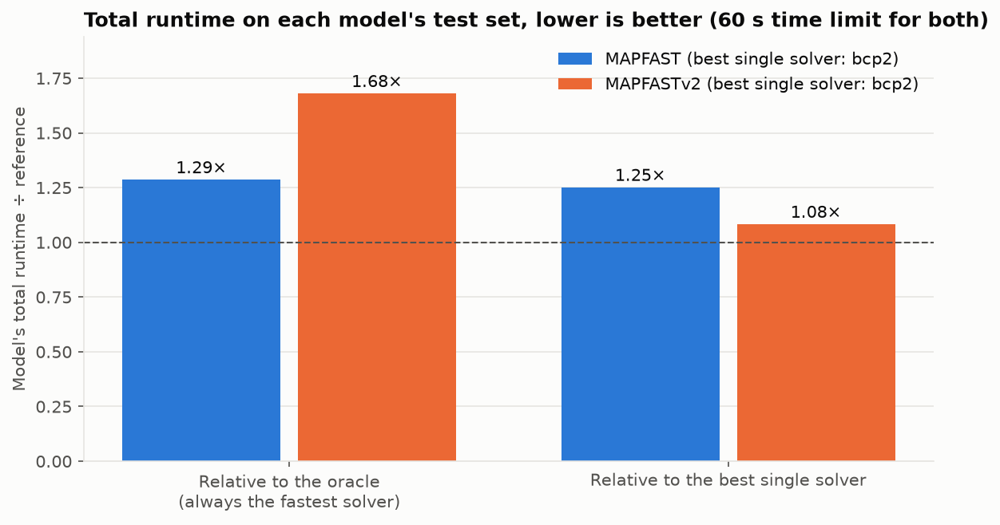
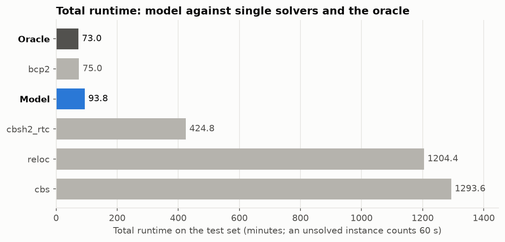
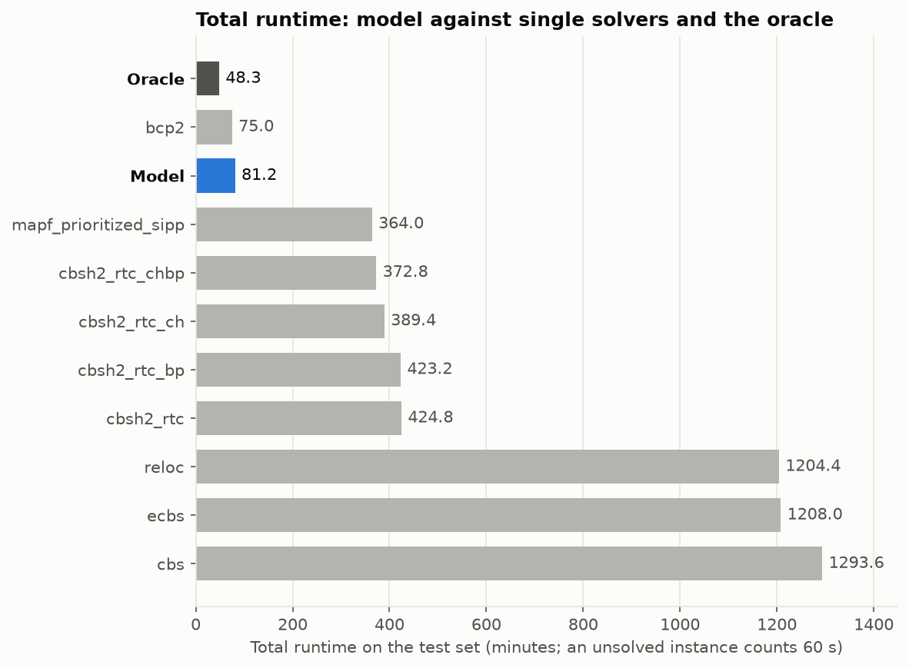
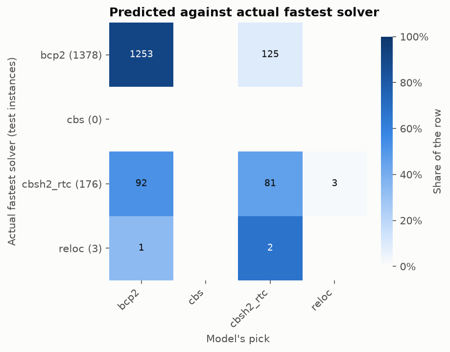
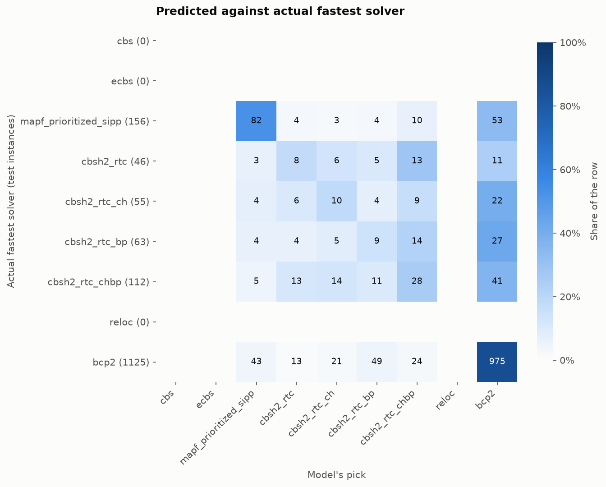
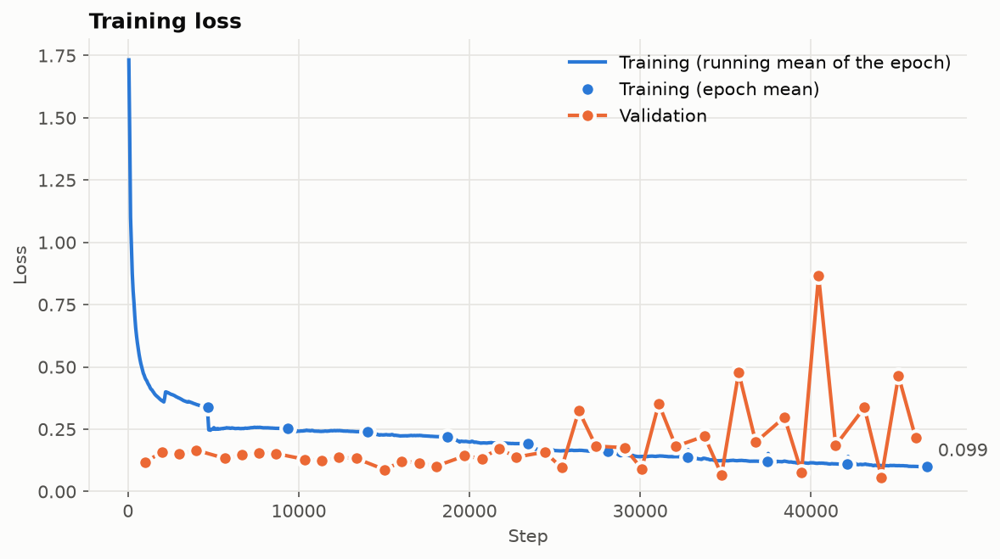
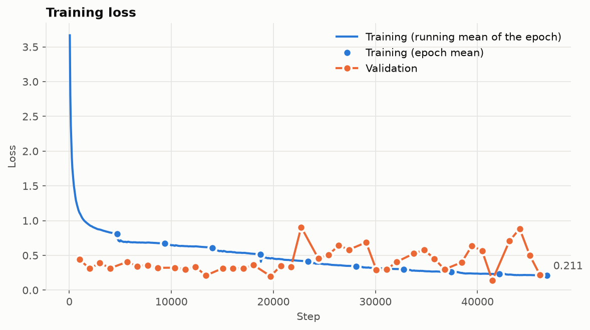

# Experiments

Each round has its own folder: Slurm logs (`<job name>_<job id>.out/.err`), per-model graphs (`<job>_plots/`), comparison graphs (`*_vs_*/`) and, where copied, the test predictions (`predictions/<model>/`).

| Folder | What |
|---|---|
| [round_0_pilot/](round_0_pilot/) | First runs on the small `movingai_pilot/nine-solvers` dataset (Oct 7) |
| [dataset_build/](dataset_build/) | Building the datasets from MAPF Benchmarking (Oct 9; round 3's later) |
| [round_1/](round_1/) | MAPFAST vs MAPFASTv2, cross-entropy (Oct 15) |
| [round_2/](round_2/) | Relative speed loss, best epoch, no SIPP, auxiliary outputs, Jev baseline |
| [round_3/](round_3/) | 300 s limit and up to 500 agents; MAPFAST-GNN against MAPFAST, MAPFASTv2 (also with 15-epoch auxiliary outputs), Jev and every solver (queued) |
| [gnn_sweep/](gnn_sweep/) | The GNN's hyperparameter sweeps, one folder per dataset |

## Round 0: pilot (Oct 7)

- Job 7094489: MAPFASTv2 on the small 9-solver dataset (342 test instances).
- Job 7094486: MAPFAST. It was cancelled after 20 minutes.

This round only checked that the training, test and plotting steps run end to end on the cluster.



## Dataset build (Oct 9)

- Job 7095349 merged 9 MAPF Benchmarking runs: 22,205 instances, 60 s limit.
- 15,594 of them are solved by one of bcp2, cbs, cbsh2_rtc or reloc. Both datasets keep exactly these instances:
  - `full_four_solvers` (now `datasets/movingai_10-200-agents_60s/four-solvers`): those four solvers.
  - `full_nine_solvers` (now `datasets/movingai_10-200-agents_60s/nine-solvers`): all nine solvers.

Datasets are named `datasets/<benchmark>/<portfolio>/[<variant>/]` since round 3 (`tools/rename_datasets.py` moved the old flat names): the benchmark they come from, the solvers to pick from, and optionally a variant on the same instances (`score`, `aux` and `score-aux` configs; `gnn` and `jev<K>` predictions of other selectors). Round 2's datasets were `full_<n>_solvers_score[_aux]`, now `movingai_10-200-agents_60s/<n>-solvers/score[-aux]`.
- bcp2 alone solves 15,569 of the 15,594.

## Round 1: MAPFAST vs MAPFASTv2, cross-entropy (Oct 15)

- Jobs 7427439 (MAPFAST: bcp2, cbs, cbsh2_rtc, reloc) and 7427440 (MAPFASTv2: all nine solvers). Comparison: job 7427441.
- All runs use a 60 s limit and the same 1,557 test instances.

| | Total runtime (min) | Always bcp2 | Oracle |
|---|---|---|---|
| MAPFAST | 93.8 | 75.0 | 73.0 |
| MAPFASTv2 | 81.2 | 75.0 | 48.3 |



| MAPFAST | MAPFASTv2 |
|---|---|
|  |  |
|  |  |
|  |  |

Problems:

- **Both lose to always-bcp2.** bcp2 solves every test instance, so a wrong pick that times out costs 60 s for nothing. 17 (v1) and 19 (v2) such picks cost about 15 min each, more than any gains.
- **Cross-entropy ignores the cost of mistakes.** Losing by 0.04 s counts the same as a 60 s timeout.
- **Little room to improve for v1.** A perfect selector saves only 2 min over bcp2, unlike the paper, where BCP failed on 13% of instances.
- **Most of v2's room comes from a non-optimal solver.** 22 of v2's 27 possible minutes come from `mapf_prioritized_sipp`, which doesn't guarantee optimal paths. Its picks saved 10.4 min; the cbsh2 picks lost 16.7.
- **Training always kept epoch 9.** v2's validation loss was lowest around epochs 2–3.
- **Accuracy is misleading.** Always picking bcp2 scores 88.5% (v1) and 72.3% (v2), so the two models' accuracies can't be compared.

## Round 2: relative speed loss, best epoch, no SIPP, auxiliary outputs, Jev baseline

Changes:

- **Loss:** 1 − expected relative speed score of the softmax. A solver scores (1 + fastest time) / (1 + its time), or 0 if it fails. This is analysis.py's custom score divided by the fastest solver's (`Training.loss: score`).
- **Best epoch:** the checkpoint with the best validation score of its picks, saved as `model_<name>_best.pth`, is the one tested.
- **No SIPP:** v2 uses eight solvers (`derive_dataset.py --drop mapf_prioritized_sipp`), all optimal except `ecbs`, which is bounded-suboptimal but is never the fastest on this data.
- **Ablation:** each of v1 and v2 is trained with and without MAPFAST's auxiliary outputs: solver finish prediction and pairwise comparison (`--aux`). The README says these didn't help in follow-up papers.
- **General-purpose baseline:** answers the reviewer objection that bespoke selectors are obsolete now that general-purpose models exist. It uses TypeSafe AI's Jev, a hosted model built for structured decisions (`jev_baseline.py`).
  - For each test instance Jev gets the map, agent count, start-goal distances and coordinates, and picks the fastest solver as a Choice question.
  - It runs twice: zero-shot (`_jev0`) and with 20 training instances from the same map plus every solver's time (`_jev20`), its best shot without training.
  - **Selector time** is recorded for both kinds of model (Jev's per-request latency; MAPFAST's inference time in the test log), since it adds to the total runtime before any solver starts.
- **Same instances and split as round 1,** so results compare directly.
- **New graph** `compare_total_runtime.png`: every model, both oracles and every solver.

Runs, with `TYPESAFE_API_KEY` set:

```bash
./scripts/compare.sh   # MAPFAST, MAPFASTv2, MAPFAST_aux, MAPFASTv2_aux, and Jev0/Jev20 on each portfolio's test instances
```

The Jev jobs start once the first model of their portfolio has been tested (`Jev0_MAPFAST`, `Jev20_MAPFAST`, `Jev0_MAPFASTv2`, `Jev20_MAPFASTv2`).

Results (Oct 19; 1,557 test instances, 60 s limit; graphs in `round_2/` on the cluster):

| | Total runtime (min) |
|---|---|
| MAPFASTv2 oracle / MAPFAST oracle | 69.5 / 73.0 |
| always bcp2 | 75.0 |
| MAPFAST, MAPFASTv2 | 75.0, 75.0 |
| MAPFAST_aux, MAPFASTv2_aux | 75.7, 76.9 |
| Jev, 20 examples (four / eight solvers) | 82.1 / 79.8 |
| Jev, zero-shot (four / eight solvers) | 424.8 / 383.7 |
| best other solver (cbsh2_rtc_chbp) | 372.8 |

- **MAPFAST and MAPFASTv2 picked bcp2 on every test instance.** Their training loss was flat from the first epoch (0.014 and 0.027): with the relative speed loss, always bcp2 is already near its optimum. Without SIPP there is little to gain: another solver beats bcp2 on 289 of 1,557 test instances, by a median of 0.04 s, and a perfect selector saves 5.5 of 75 min (7%).
- **The auxiliary outputs made it leave bcp2, and lose time** (0.7 and 1.9 min). Their losses kept falling over the 10 epochs, mostly the auxiliary heads.
- **Jev:** with 20 examples it stays close to bcp2 but behind every trained model; zero-shot it is 5–6 times slower than bcp2, behind most single solvers.

## Round 3: harder instances, GNN selector (queued)

Plan:

- **Harder benchmark:** round 1's benchmark (60 s, 10–200 agents) is extended: every run it did not solve is rerun with a **300 s** limit, and **250–500 agents** are added on the scenario files that have them (MAPF Benchmarking's `extend_benchmark.py`). Per scenario file and solver the runs go up in agent count and stop at the first failure, so a solver that cannot keep up costs at most one timeout per file. In MAPF Benchmarking, round 1's benchmark becomes the experiment `movingai_10-200-agents_60s` and the extension `movingai_10-500-agents_300s`.
- **Datasets:** `movingai_10-500-agents_300s/four-solvers` (MAPFAST) and `movingai_10-500-agents_300s/eight-solvers` (MAPFASTv2 and MAPFAST-GNN, no SIPP), labelled with the 300 s limit.
- **Three selectors, from basic to new:**
  - **MAPFAST:** the original CNN on the four-solver portfolio, cross-entropy on the fastest solver (the best epoch by validation accuracy).
  - **MAPFASTv2:** the same network and loss on the eight-solver portfolio.
  - **MAPFAST_aux, MAPFASTv2_aux:** both with MAPFAST's auxiliary outputs, trained for **15 epochs** instead of 10, since their losses were still falling in round 2: can the extra outputs get past bcp2?
  - **MAPFAST-GNN** (`models/gnn.py`, `models/train_gnn.py`): a new architecture and objective, on the eight-solver portfolio.
    - Input: the map as a grid graph, coarsened to at most 64 × 64 blocks, with per-block features (free space, starts, goals, cells on agents' shortest paths, path overlap) and global ones (agents, density, path lengths).
    - **Regret loss:** the expected seconds a pick loses to the fastest solver, with a timeout costing the full 300 s, so the 0.04 s wins over bcp2 barely count and timeouts count the most.
    - **Fallback rule:** it leaves the default solver (lowest total training runtime, e.g. bcp2) only when its top pick's probability reaches a threshold tuned on the validation set, so at worst it matches always-bcp2.
    - **Selection by runtime, not accuracy:** epochs, thresholds and configurations are ranked by validation speedup over always-bcp2. Accuracy rewards picking bcp2, which is what made round 2 collapse.
    - A sweep of 144 configurations (GCN, GraphSAGE, GIN; width 32–256; depth 2–8; two learning rates; cross-entropy or regret loss; `scripts/sweep_gnn.sh`, figure `gnn_sweep/movingai_10-500-agents_300s/eight-solvers/sweep.png`).
- **Comparison** into `round_3/`: MAPFAST, MAPFASTv2, their auxiliary-output versions, MAPFAST-GNN, Jev with 20 examples on both portfolios (zero-shot dropped: far behind in round 2), and every single solver and both oracles (`compare_total_runtime.png`). Training jobs get 24 h, as the datasets are larger and the auxiliary models train for 15 epochs. Everything is tested on the same instances: MAPFAST-GNN uses MAPFASTv2's split.

Queue: [`round_3/queue.sh`](round_3/queue.sh), plain Slurm jobs kept out of the reusable scripts. From `~/MAPFASTv2` on the cluster login node:

```bash
cd ~/MAPF-Benchmarking && git pull
cd ~/MAPFASTv2 && git restore datasets && git pull     # the restore brings back the tracked datasets deleted on the cluster
./experiments/round_3/queue.sh                          # reads the Jev key from typesafe_key.txt (not tracked)
```

1. Once round 2's jobs have ended: MAPF Benchmarking's old `output/` and `logs/` into its `experiments/`, and the datasets into their folders (`tools/rename_datasets.py`).
2. The 300 s / 500-agent extension and the datasets (`generate_benchmark.sh extend movingai_10-200-agents_60s`); this job queues step 3 once it knows the dataset job.
3. The eight-solver dataset, the auxiliary-output variants, the MAPFAST-GNN sweep (`sweep_gnn.sh`) and the comparison (`compare.sh`), held until the sweep has chosen MAPFAST-GNN's best configuration.

If a job fails, the jobs after it stay pending as `DependencyNeverSatisfied`: cancel them (`scancel`), fix the cause, and run the rest of the steps by hand.

Results: _to fill in_.
